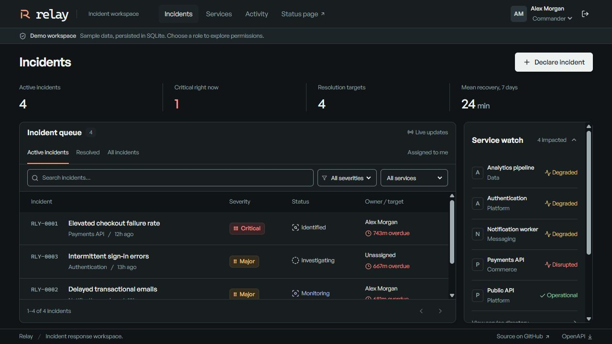

# Relay

An incident workspace with ownership, recovery stages and live updates. .NET 10, ASP.NET Core Identity, EF Core, SQLite, SignalR, React and TypeScript.



## Run

.NET 10 SDK and Node.js 22.12+.

```powershell
.\run.ps1
```

On macOS/Linux, use `sh run.sh`. Open http://localhost:5180 and choose **Explore as commander**. The Development profile seeds fictional incidents and enables role switching. SQLite and encryption keys persist in `src/Relay.Api/data/`.

For frontend hot reload, run `npm --prefix web run dev` alongside the API.

Docker: `docker compose up --build` serves the same local development app on port 5180.

## Check

```sh
dotnet test Relay.sln
npm --prefix web ci
npm --prefix web test
npm --prefix web run build
```

With the app running against a disposable database, install Chromium from `web` using `npx playwright install chromium`, then run `npm --prefix web run test:e2e`.

## Deploy

Use a new database and configure secrets on the host:

```text
ASPNETCORE_ENVIRONMENT=Production
Demo__Enabled=false
Bootstrap__Email=<administrator email>
Bootstrap__Password=<unique password, at least 12 characters>
ConnectionStrings__Relay=Data Source=/persistent/relay.db;Default Timeout=10
```

Bootstrap creates the first administrator only when no users exist. Serve over HTTPS and preserve the database and Data Protection keys. Configure any trusted reverse proxy explicitly.

[Architecture and API decisions](docs/architecture.md) · [CI checks](.github/workflows/checks.yml)

General Sans: [Fontshare Free Font License](web/public/fonts/LICENSE.txt). Icons: Lucide, ISC.
